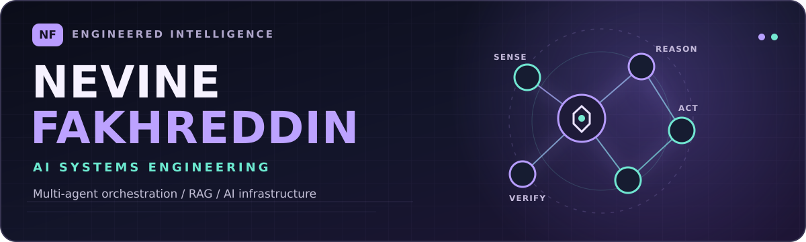
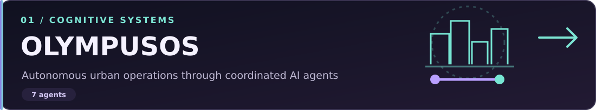
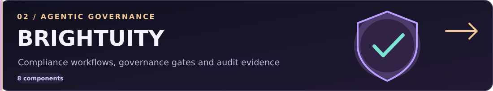
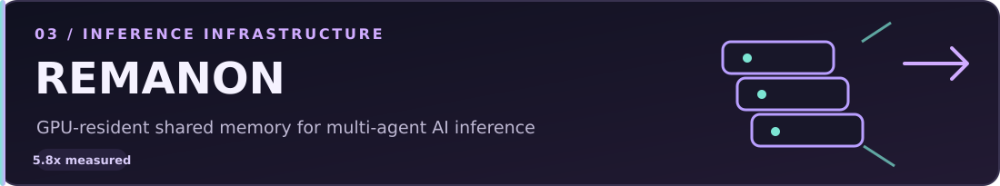

<!--
  GitHub profile README for @NevineAKF
  Original visual assets live in ./assets/ .
  External icon cards: skillicons.dev, shields.io, GitHub Stats Extended,
  and GitHub Readme Streak Stats. Their availability depends on the providers.
-->

  

  <strong>AI Engineer &amp; Systems Designer</strong> 
  I build and prototype intelligent systems, from specialized agents to orchestration, governance, and infrastructure.

  
  

---

### ✦ &nbsp; What I Engineer

<table>
  <tr>
    <td align="center" width="33%"><strong>◈ Multi-Agent Systems</strong> Agent roles · Orchestration · Coordination</td>
    <td align="center" width="33%"><strong>◇ Trust &amp; Governance</strong> Human oversight · Evidence · Audit trails</td>
    <td align="center" width="33%"><strong>⬡ AI Infrastructure</strong> Inference · Memory · Runtime efficiency</td>
  </tr>
</table>

### ✦ &nbsp; Selected Engineering Projects

<b>Orchestration · Crisis simulation · Urban intelligence</b> — A seven-agent system coordinating perception, forecasting, mobility, safety, and decisions in a simulated mass-event scenario. <a href="https://github.com/NevineAKF/OlympusOS">Repository →</a>

<b>Agentic governance · Risk assessment · Auditability</b> — An eight-component workflow for asset tokenization compliance with deterministic controls, evidence packaging, and final human authorization. <a href="https://github.com/NevineAKF/Brightuity">Repository →</a>

<b>AI inference · GPU memory · Runtime architecture</b> — A shared-context runtime with measured 5.8× cold-to-warm reuse speedup on its documented AMD test setup. <a href="https://github.com/NevineAKF/remanon">Repository →</a>

### ✦ &nbsp; Engineering Toolbox

**AI & Machine Learning**

  

**Backend & Infrastructure**

  

**Agentic Architectures & Applied Workflows**

  
  
  
  
  

### ✦ &nbsp; More Work

- **[Document-QA-Bot](https://github.com/NevineAKF/Document-QA-Bot)** — PDF-grounded question answering using RAG, LangChain, and Gradio.
- **[Sentiment Analysis — Linear Classifiers](https://github.com/NevineAKF/Sentiment-Analysis-Linear-Classifiers)** — Perceptron, averaged perceptron, and Pegasos models from MITx 6.86x.

### ✦ &nbsp; GitHub in Numbers

  
  

  

Statistics update from third-party providers and may not include all private work. Language distribution reflects repositories, not skill proficiency.

---

  Systems thinking · Structured orchestration · Verifiable outcomes

